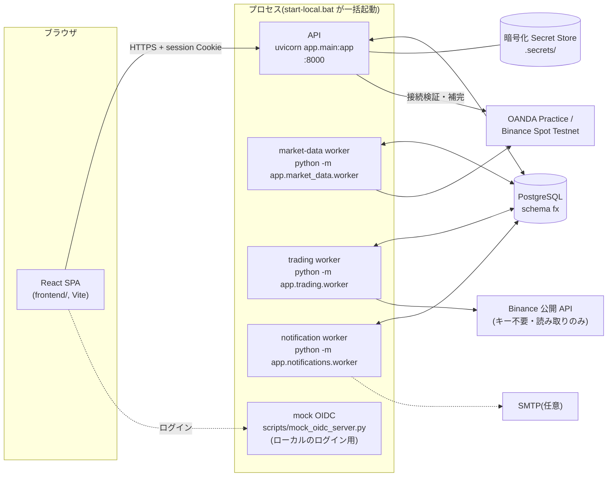
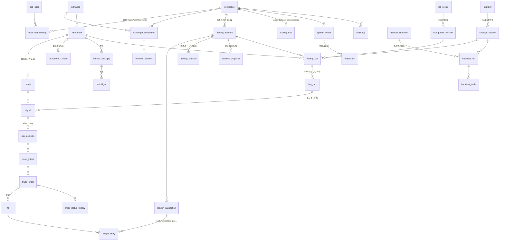
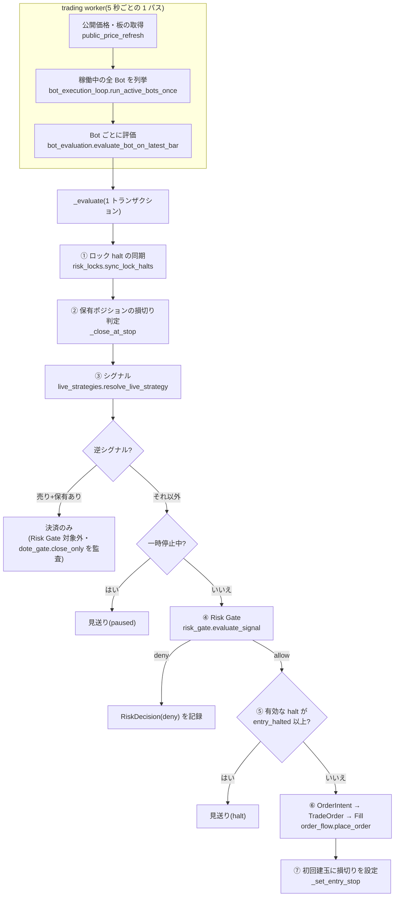
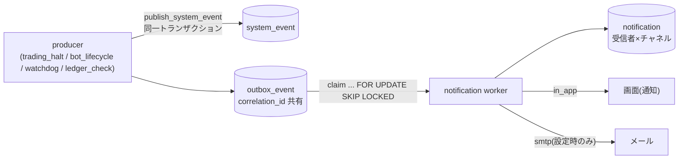

# システム仕様書(開発者向け)

> 対象: このリポジトリを読み書きする開発者・Agent。最終更新: 2026-10-12(Alembic `20261007_0011` / `docs/plans` の機能一式が main に入った時点)。
> 非エンジニア向けの説明は [../overview/01-system-overview.md](../overview/01-system-overview.md)・[../overview/02-trading-logic.md](../overview/02-trading-logic.md)。
> **API の全エンドポイントは [api/reference.md](api/reference.md)、全テーブルの列は [database/schema-reference.md](database/schema-reference.md)**(どちらもコードから自動生成。このファイルには複製しない)。

## 0. 前提と範囲

- **ペーパー/テストネット専用。** 本番取引・実資金は扱わない(`TRADING_ENV=paper`、`LIVE_TRADING_ALLOWED=false` が既定。取引所アダプターは Practice/Testnet 以外のエンドポイントを拒否する)。この制限を緩める変更は別プロジェクト扱いで、勝手に行わない。
- 構成: **モジュラーモノリス**(FastAPI + SQLAlchemy 2 + PostgreSQL)、独立起動する 3 つの Worker、React/Vite のフロントエンド。ネットワーク越しのマイクロサービスには分割しない([../architecture/current-and-target.md](../architecture/current-and-target.md))。
- 設計判断は ADR(`docs/decisions/0001〜0006`)と、機能ごとの計画(`docs/plans/`、索引は [../plans/README.md](../plans/README.md))にある。
- 設計と実装が食い違うときは、実装を黙って正とせず、`AGENTS.md` §2 の手順で報告する。

## 1. 実行時の構成



| プロセス | 起動 | 役割 | 周期・設定 |
|---|---|---|---|
| API | `uvicorn app.main:app`(`fastapi dev`) | HTTP/JSON、OIDC ログイン、RBAC、WebSocket(`/ws/v1/market-stream`) | — |
| market-data worker | `python -m app.market_data.worker` | 購読(`market_data_subscription`)の定期取得と、補完ジョブ(`backfill_job`)の実行。`market_data_lease` でリース+ハートビートし、複数起動に耐える | `WORKER_SCAN_INTERVAL_SECONDS`(2s)、`WORKER_LEASE_SECONDS`(90)、`WORKER_HEARTBEAT_INTERVAL_SECONDS`(15) |
| trading worker | `python -m app.trading.worker` | ①`binance_public` の公開価格・板(bid/ask)を取得して `candle`/`instrument_spread` に保存 ②稼働中(`running`/`paused`)の全 Bot を 1 パス評価 | `BOT_EXECUTION_POLL_INTERVAL_SECONDS`(5s)。1 Bot の失敗は他を止めない。連続 5 回失敗した Bot は `failed` へ |
| notification worker | `python -m app.notifications.worker` | Outbox を `FOR UPDATE SKIP LOCKED` で取り出し通知を配信。**5 分ごとに台帳照合**、各 Worker の停止監視(ウォッチドッグ) | `NOTIFICATION_POLL_INTERVAL_SECONDS`(5s)。メールは `SMTP_*` が揃うときだけ(`in_app` は常に動く) |
| mock OIDC | `scripts/mock_oidc_server.py` | ローカル専用のログイン用 IdP | `:9000`。本番相当の IdP は `OIDC_*` で指定 |

- ローカル一括起動は `start-local.bat` → `scripts/start_local.py`(API・Vite・3 Worker・mock OIDC。DB が Alembic head より古いと警告。`--no-trading-worker` あり)。
- Worker は **シグナル処理・エンジン生成・CLI を `__main__.py` に、スケジューリングを別モジュールに**置く(テスト容易性のため)。
- 依存方向は `API/Worker → Application → Domain`、Application → Infrastructure。**Application 層は `HTTPException` を投げず、FastAPI のスキーマを返さない。** API 層に取引所固有ルールを書かない。

### 設定(`app/core/config.py`、`.env`)

環境変数名は設定名の大文字(例 `session_ttl_seconds` → `SESSION_TTL_SECONDS`)。雛形は `.env.example`。

| 分類 | 設定(既定値) |
|---|---|
| 基本 | `APP_ENV`(local)、`DATABASE_URL`、`DATABASE_SCHEMA`(fx)、`CORS_ORIGINS`、`LOG_DIR`/`LOG_LEVEL`/ローテーション |
| 取引制限 | `TRADING_ENV`(paper)、`LIVE_TRADING_ALLOWED`(false) |
| 秘密情報 | `SECRET_ENCRYPTION_KEY`(Fernet)、`SECRET_STORE_PATH`(.secrets)。DB には `secret_ref` だけを置く |
| 認証 | `OIDC_ISSUER`/`OIDC_CLIENT_ID`/`OIDC_CLIENT_SECRET`/`OIDC_REDIRECT_URI`/`OIDC_SCOPES`、`SESSION_SIGNING_SECRET`、`SESSION_TTL_SECONDS`(8h)。OIDC 未設定だと `/auth/login` は 503 |
| 市場データ | `WORKER_*`(上表)、`MARKET_STREAM_TICKET_SECRET`/`_TTL_SECONDS`(60)/`_GRACE_PERIOD_SECONDS`(30)/`_HEARTBEAT_INTERVAL_SECONDS`(30)。ticket secret 未設定だと WS ticket 発行は 503 |
| 通知 | `SMTP_HOST`/`PORT`(587)/`USERNAME`/`PASSWORD`/`USE_TLS`/`SENDER_ADDRESS`、`NOTIFICATION_POLL_INTERVAL_SECONDS` |
| 監視 | `TRADING_WORKER_STALE_SECONDS`(180)、`MARKET_DATA_WORKER_OVERDUE_SECONDS`(600) |

## 2. コード構成(`app/`)

| パッケージ | 責務 |
|---|---|
| `api/routes/` | HTTP の入出力変換のみ。`auth` `workspaces` `connections` `instruments` `market_data` `market_data_gaps` `market_stream_ws` `trading` `trading_halts` `trade_history` `decision_history` `backtests` `events` `notifications` `system_status` `client_logs` |
| `schemas/` | Pydantic の入出力スキーマ(API ごと) |
| `security/` | `oidc.py`(Authorization Code + PKCE)、`session.py`(署名 Cookie・失効)、`rbac.py`(`require_viewer/operator/owner` 等の依存関数)、`secret_store.py` |
| `models/` | SQLAlchemy ORM(`workspace` `connections` `instruments` `market_data` `strategy` `trading` `backtest` `audit` `notifications`)。**42 テーブル**(スキーマ `fx`) |
| `connections/application/` | 取引所接続の検証・口座同期 |
| `exchanges/` | `oanda.py` `binance.py`(テストネット)`binance_public.py`(公開価格)、`types.py`(時間足と秒数の対応など) |
| `market_data/{application,domain,infrastructure,worker}` | 取得・補完・リース・欠損検出・WebSocket 配信。アクセス判定は `infrastructure/access.py` に集約(後述 §10) |
| `trading/application/` | 取引の中核(§4〜§9)。`trading/worker/` が評価ループの入口 |
| `notifications/{application,adapters,worker}` | Outbox の配信、`in_app`/`smtp` アダプター、受信者解決 |
| `monitoring/` | `system_status.py`(全体の健康状態の集約)、`event_log.py`(`system_event` の検索) |
| `db/` | `SessionLocal`、`Base` |

フロントエンド(`frontend/src/`): `features/{auth,connections,instruments,market-data,trading,backtests,system-status,notifications,event-log,data-gaps,trade-history,decisions,health,workspaces}`、`components/`(`CandleChart` ほか)、`pages/`、`lib/`(API クライアント等)。チャートは lightweight-charts v5。

## 3. データモデルの要点

全列は [database/schema-reference.md](database/schema-reference.md)。ここでは関係と規約だけを示す。

- 主キーは UUID(`gen_random_uuid()`)、金額・数量は `NUMERIC(38,18)`(API では**文字列**で返す)、時刻は `timestamptz`(**サーバーのローカル時刻で返ることがある** — [../knowledge/database-times-are-not-utc.md](../knowledge/database-times-are-not-utc.md))。
- CHECK 制約と一部の索引は Alembic 側にだけある(`alembic/versions/`、最新 `20261007_0011`)。
- すべてのワークスペース資源は `workspace_id` で範囲が決まる。



> 上の図は主要な関係だけ(`outbox_event`、`session_revocation`、`account_selection_policy`、購読・補完の詳細は省略)。正確な FK は schema-reference.md。

設計上の規約:

- **台帳が正。** 残高・損益・資産は `ledger_entry`(`cash`/`fee`/`deposit`/`withdrawal`/`realized_pnl`)から計算する。`account_snapshot` は資産の時系列(日次・週次損失、ピーク DD の基準)。
- **1 つの停止原因につき、`trading_halt` の有効行は 1 つ**(`(workspace, scope_type, scope_id, reason_code)`)。エスカレート/緩和は同じ行の `level` を書き換える。
- `signal` は `(bot_run_id, candle_id)` で冪等。同じ足を 2 回評価しても行は増えない。
- `client_order_id` の接頭辞が決済の契機を表す: `dummy-`(新規)、`stop-`(損切り)、`dote-close-`(逆シグナルによる決済のみ)、`emergency-close-`(緊急停止)。
- `audit_log` は業務イベント(誰が・何を・前後の値)、`system_event` は運用上の出来事(カテゴリは market_data/connection/strategy/model/risk/order/fill/system/security/notification)。通知は `system_event` を起点に作る。

## 4. 取引パイプライン

### 4.1 全体



- 入口: `bot_execution_loop.run_active_bots_once` → `bot_evaluation.evaluate_bot_on_latest_bar(db, bot, bot_run)` → `_evaluate`。**1 評価 = 1 トランザクション**。例外時は全体をロールバックし、`EvaluationFailureTracker` が連続失敗を数える(閾値 5 で `bot_lifecycle.fail_bot`)。DB 接続障害(`OperationalError`/`InterfaceError`)は Bot のせいではないので数えない。
- 評価のたびに `bot_run.heartbeat_at` を更新する。`worker_watchdog`(trading)がこれを見て Worker の停止を検知する。
- 取り込めていない足は評価しない(最新の確定足のみ)。Worker 停止中に閉じた足の新規エントリーは生成されない(損切りは後続の足で検知される)。`paper_parity.find_unevaluated_bars` がその漏れを列挙する。

### 4.2 戦略(シグナル)

- `live_strategies.resolve_live_strategy(definition)` が、`strategy_version.definition`(JSON)から実行対象を解決する。解決できない定義は `UnresolvableStrategyError`。
- 承認済みの定義: **Donchian ブレイクアウト**(`donchian_breakout_signal.py`)。`entry_period=55`、`exit_period=20`、`exit_policy="stop_loss"`、時間足 `4h`、`history_window` 分の確定足を使う。戦略名は `donchian-55-20-stop-loss`(比較用は `donchian-110-40-stop-loss`)。
  - **買い**: 最新確定足の終値が、直前 `entry_period` 本の最高値を超え、かつ**その前の足は超えていない**(最初の足だけ)。
  - **売り**: 終値が直前 `exit_period` 本の最安値を割る。
  - それ以外は `hold`。
- 研究用の戦略(`ema_trend_signal` `rsi_mean_reversion_signal` `confluence_signal` `dummy_signal`)はバックテスト/比較のためのもので、**Bot の作成画面・API は承認済みの戦略/時間足でしか作れない**(`paper_provisioning.APPROVED_*`)。
- 新しい戦略を追加するときは、バックテスト(§9)で検証してから `live_strategies` に載せる。検証の道のりと結論は `docs/plans/{rolling-walk-forward,multi-asset-diversification,decision-timeframes,stop-monitoring-timeframes,confluence-filters}.md`。

### 4.3 損切り(`bot_evaluation`)

- 損切り価格は**最初のエントリーで 1 回だけ**設定する: `fill_price − stop_distance`(`_entry_stop_price`、ロング)。ピラミッディングしても動かさない。`trading_position.stop_price`(Alembic `20261002_0010`)に保存。
- 判定は**次の足から**。足の安値が損切り価格以下なら決済。足の**始値が損切り価格より下**(窓開け)なら始値で約定(`_stop_exit_price`)。決済注文は `client_order_id` 接頭辞 `stop-`、`close_reason` は損切り。
- 利確・トレーリングは実装しない(検証で不採用 — `docs/plans/rolling-walk-forward.md`)。

### 4.4 逆シグナルと「ドテン」

保有と逆向きのシグナルは、**決済のみ**を実行する(反転はしない)。決済は Risk Gate の対象外(リスクを減らす行為のため)で、`audit_log` に `dote_gate.close_only` を残す。Binance(ロングのみ)では、保有が無いときの売りは `binance_no_short` で Risk Gate が拒否する。

## 5. Risk Gate(`risk_gate.py`、`conservative-v1`)

入力: シグナル・口座・銘柄・Bot・取引所コード。出力: `RiskDecision`(`outcome`: `allow`/`allow_with_adjustment`/`deny`、`reason_code`、`rule_results`(JSON、各検査の `passed`+詳細)、`adjusted_quantity`)。純粋関数部分は `_evaluate_conservative_v1(RiskState)`(バックテストの `backtest_replay` も**同じ関数**を呼ぶ — ペーパーとバックテストで判断が食い違わないための設計)。

### 5.1 ルール値(`CONSERVATIVE_V1_RULES`)

| ルール | 初期値(超過で deny) | hard(超過で deny+halt) |
|---|---|---|
| `risk_per_trade`(1 取引の想定損失/資産) | 0.005 | 0.02 |
| `all_open_risk_limit`(全建玉の想定損失合計) | 0.015 | 0.05 |
| `daily_loss_limit` | 0.02 | 0.05 |
| `weekly_loss_limit` | 0.04 | 0.08 |
| `peak_drawdown_limit` | 0.05 | 0.10 |
| `consecutive_loss_limit` | 3 | 7 |
| `min_reward_risk` | 2.0 | 1.0 |
| `min_order_interval_minutes` | 15 | 1 |
| `max_data_delay_bars` | 2 | 5 |

取引所別: Binance `stop_atr_multiplier=2.0`・`stop_spread_multiplier=3.0`・`fee_rate=0.001`・`order_limit_pct_of_available=0.10`・`btc_holding_cap_pct_of_equity=0.25`。OANDA `leverage_cap=3.0`・ATR 倍率 1.5。

> `min_reward_risk` はブレイクアウト戦略(利確なし)には適用しない(`reward/risk not applicable`)。値は設定として残してある。

### 5.2 数量の決め方

```text
stop_distance        = max(ATR(14) × stop_atr_multiplier, spread × stop_spread_multiplier [, OANDA の最小幅])
stress_adjusted_stop = stop_distance + expected_slippage + fee_buffer_per_unit
raw_quantity         = equity × risk_per_trade / stress_adjusted_stop
exposure_limit_qty   = (equity × all_open_risk_limit − existing_open_risk) / stress_adjusted_stop
broker_limit_qty     = Binance: available_cash × 0.10 / price   (instrument.max_quantity と小さい方)
                       OANDA : equity × leverage_cap / price
quantity             = floor_to_step_size( min(raw, exposure_limit, broker_limit) )
```

- `expected_slippage` は `instrument_spread` の bid/ask から(Binance=spread×1.0、OANDA=spread×0.5。行が無ければ 0)。`fee_buffer_per_unit` は Binance=価格×0.1%、OANDA=0。
- `quantity ≤ 0` または `min_quantity` 未満なら deny(`hard_limit_breach`)。`quantity < raw_quantity` なら `allow_with_adjustment`。
- 既存建玉の想定損失(`existing_open_risk`)は**現在の含み損で近似**する(損切り価格まで下がった損失そのものではない)。
- 保有上限・連敗・DD・日次/週次損失・発注間隔・データ遅延・Binance 固有(空売り禁止、BTC 保有 25% 上限)は `rule_results` に個別の `passed` と数値で残る。`reason_code`: `hard_limit_breach`/`initial_threshold_breach`/`binance_no_short` ほか。
- `equity ≤ 0` は評価の手前で deny。

### 5.3 取引停止(halt)

`trading_halt` の `level`: `warning`(1)< `entry_halted`(2)< `all_trading_halted`(3)< `emergency_stopped`(4)。`scope_type`: `bot`/`account`/`workspace`。`status` は `active`/`released` のみ(`release_pending` は使わない — ADR 0004)。

| `reason_code` | 検知 | 範囲 | 解除 |
|---|---|---|---|
| `data_delay` | Risk Gate(足の遅れが `max_data_delay_bars` 超) | Bot | データ回復で 1 段ずつ自動(`deescalate_one_step`) |
| `daily_loss_dd_limit` | Risk Gate(日次・週次損失・DD の hard 超過) | 口座/Bot | 基準内に戻れば 1 段ずつ自動 |
| `consecutive_loss_limit` | `risk_locks.sync_lock_halts`(毎足) | 口座 | **Owner が直接解除。解除時点から数え直す** |
| `peak_drawdown_limit` | 同上 | 口座 | 同上(ピークも解除後の資産だけで測る) |
| `ledger_mismatch` | `ledger_check`(通知 Worker が 5 分ごと) | 口座(`emergency_stopped`) | 直した上で Owner。解除時に照合を再実行し、まだ不整合なら **409** |
| `user_emergency_stop` | `emergency_stop`(API/`scripts/emergency_stop.py`) | Bot/ワークスペース | Owner のみ。Bot は停止のまま |

- 有効な halt の `level >= entry_halted` は、**新規/増加の注文だけ**を止める。決済(損切り・反対売買・緊急決済)は通る。`place_order` も同じ判定を持つ(Risk Gate を通らない経路の防波堤)。
- 連敗・DD を**自動解除しない**理由: 練習で一時的に戻っても、戦略が信頼できる状態に戻ったとは言えないため(`risk_locks` の docstring、`docs/plans/lock-halts.md`)。
- 緊急停止は `emergency_stop_bot` / `emergency_stop_workspace`。オプションで建玉を成行決済(`emergency-close-`)し、Bot を `stopped` にする。
- halt の発生・段階変更は `publish_system_event` で通知(§8)。

## 6. 注文・約定・台帳(`order_flow.py`)

- `create_order_intent` → `place_order`。**ペーパーは完全に自前のシミュレーション**: 取引所へは何も送らない。注文は即 `submitted` → 同期的に約定する。
- 約定価格: 銘柄の**最新確定足の終値**(シグナルを出した足の終値と一致する)。手数料: Binance は約定代金×0.1%。スリッページは `instrument_spread` から見積もる(§5.2)。
- `trading_position`: 口座×銘柄で未決済 1 行。OANDA は**ネット**(`side` が long/short で入れ替わる。超過約定は 1 回で反転)、Binance は**ロングのみ**(保有を超える売りは `OrderFlowError("short_not_supported")`)。
- 約定ごとに `ledger_transaction` + `ledger_entry`(約定代金・手数料・実現損益)を書き、`account_snapshot` を追記(`account_valuation.record_account_snapshot`)。`TradeOrder.status` の遷移は `order_status_history` に残る。
- 資産(equity) = 現金残高 + 保有の含み損益(最新確定足の終値)。`account_valuation.value_account` が唯一の算出元(Risk Gate・Bot 管理画面・照合が同じ値を使う)。
- 初期資金は `account_funding.seed_paper_deposit`(`deposit`)で入れる。Bot ごとの口座に 166,667 USDT(6 銘柄で合計 100 万 USDT)。
- **台帳の照合**(`ledger_reconciliation.reconcile`、純粋関数 / `ledger_check` が口座ごとに実行): 約定・注文・台帳・建玉の整合を検査し、食い違えば `ledger_mismatch` の halt を張って通知する。

## 7. Bot のライフサイクル(`bot_lifecycle.py`)

`actual_state`: `stopped` → `running` ⇄ `paused` → `stopped`、異常時 `failed`。`start_bot` は `bot_run` を新規作成し、`validate_bot_startup` が前提(承認済み戦略・Risk Profile・接続・口座・銘柄)を検証する。`pause_bot`/`resume_bot`/`stop_bot`/`fail_bot` は監査ログ(`audit_log`)を残し、停止・失敗時は未約定の注文をキャンセルする。`fail_bot` は Owner/Operator に `error` 通知を送る。

プロビジョニング: `paper_provisioning.create_approved_bot`(承認済みの戦略/リスクプロファイルの版を `ensure_approved_versions` で用意し、口座・入金・Bot を作る)。CLI は `scripts/provision_paper_bot.py`。ペーパーの成績は `scripts/report_paper_performance.py`、ライブとバックテストの一致検査は `scripts/check_paper_parity.py`。

## 8. 通知・イベント・監視



- `publish_system_event` が `system_event` と `outbox_event` を**同じ `correlation_id` で**書く。`notification.event_id` は `system_event.id`(`outbox_event.id` ではない)を指す。
- 受信者は、ワークスペースの Owner と Operator(`recipients.workspace_member_recipients`)。
- 配信は at-least-once。受信者がすべて `sent` になったら `published`。失敗は指数バックオフで再試行(最大 5 回、超えたら `failed`)。再試行では `sent` 済みの受信者を再送しない。アダプターの無いチャネル(SMTP 未設定の email)は**スキップ**(失敗ではない)。
- 監視: `monitoring/system_status.py` が API(DB)・各 Worker の稼働(trading=`bot_run.heartbeat_at`、market-data=リース/ハートビート)・有効 halt・通知を集約し、`GET /workspaces/{id}/system-status` に出す。`monitoring/event_log.py` が `system_event` を時刻・重要度・カテゴリ・Bot・相関 ID・原因コードで検索する(`GET /workspaces/{id}/events`)。

## 9. 市場データとバックテスト

### 9.1 市場データ

- 取得元: OANDA Practice / Binance Spot Testnet(認証あり、market-data worker)、Binance 公開 API(キー不要、trading worker が `binance_public` の銘柄だけ)。
- `candle` は確定足のみ保存(銘柄×時間足×開始時刻で一意)。補完は `backfill_job`(`queued → running → validating → …`)、欠損は `market_data_gap`(`GET /workspaces/{id}/market-data-gaps`、`…/{gap_id}/backfill` で補完を enqueue。無視した欠損の既定非表示/切替)。
- 取引所メンテナンス等による欠損は実在する(BTCUSDT 4h で 17 本)。`gap_reports` が一覧・影響(どの Bot が何本評価できなかったか)を算出する。
- WebSocket(`/ws/v1/market-stream`)はチャートのリアルタイム表示用。ticket(署名・TTL 60s)で接続する。
- `instrument_spread`(最新)と `instrument_spread_history`(5 分間隔の履歴)に bid/ask を保存する。

### 9.2 バックテスト(`backtest_*`)

- 経路: `backtest_provisioning`(`dataset_snapshot` の作成=範囲・件数・チェックサム、戦略/リスクプロファイルの版の用意)→ `backtest_replay.run_replay`(足を 1 本ずつ進め、**ライブと同じ `risk_gate._evaluate_conservative_v1` と `backtest_fill`**(`order_flow` の式の純粋関数版)を使用。DB の口座・建玉・台帳には書かない)→ `backtest_metrics.persist_backtest_run`(`backtest_run`/`backtest_trade`)。
- 複数銘柄: `backtest_batch`(同期実行。全銘柄の合計バー数が `MAX_BATCH_BARS=300,000` を超える要求は、実行前に**丸ごと拒否**して銘柄ごとの本数を返す)。
- 指標: 損益(手数料・スリッページ込み)、最大 DD、Profit Factor、勝率、取引数、ベースライン(買い持ち)との差など(`compute_metrics`/`compare_to_baseline`)。
- ウォークフォワード: `backtest_walk_forward`(単純分割)、`backtest_robustness`(ローリング。ロック halt が一度掛かると平らな口座では解けないため、30 日窓ごとに平らな状態から開始する)。研究用スクリプトは `scripts/research/`(`run_walk_forward_report.py` ほか)、公開履歴の取得は `scripts/fetch_binance_public_history.py`、検証は `scripts/validate_public_history.py`。
- **注意**: 結果の読み方(生存バイアス、2025〜26 年の低下、リスク優先の評価)は [../overview/02-trading-logic.md](../overview/02-trading-logic.md) §8 と各検証メモを参照。

## 10. 認証・認可・セキュリティ

- ログイン: OIDC Authorization Code + PKCE(`/auth/login` → IdP → `/auth/callback`)。成功すると署名付き `session` Cookie(`HttpOnly`・`SameSite=Strict`、TTL 8h)。ログアウトと「全セッション失効」(`/auth/sessions/revoke`、Owner による他人の失効 `/auth/users/{id}/revoke-sessions`)があり、失効は `session_revocation` で管理(Alembic `0008`)。
- 認可: ワークスペース内の **Viewer < Operator < Owner**。`rbac.require_viewer/operator/owner` を FastAPI の依存として使う。資源が他ワークスペースのものなら 404(存在を明かさない)。
- 秘密情報: 取引所の API キーは暗号化した Secret Store に置き、DB には `secret_ref` のみ。外部口座の ID は暗号化+ハッシュ+マスクで保持し、API には出さない。検証・接続変更は監査ログ(資格情報の値は含めない)。
- 取引所アクセスの判定: `market_data/infrastructure/access.py` に集約。**`WorkspaceAccountSelection` を参照してよいのはこのファイルだけ**(アーキテクチャガードテストで強制)。公開 API の読み取り用には `access.readable_instrument_ids` を使う。
- 入力は Pydantic で検証し、SQL は ORM/バインド変数のみ。クライアントログ(`/client-logs`)の受け口はサイズ・内容に制限がある。
- 実装上の既知の制約: `docs/knowledge/` を参照(例: UTC ではない DB 時刻、テストが「DB が落ちている」ことを前提にしてはならない、など)。

## 11. テストと品質ゲート

| 種類 | 場所/コマンド | 備考 |
|---|---|---|
| 静的解析 | `ruff check .`、`ruff format --check .`、`mypy`(`pyproject.toml`、対象 `app` `scripts`) | |
| Python テスト | `pytest`(既定は DB 不要のもの) | MagicMock/monkeypatch 中心の単体テスト |
| 実 PostgreSQL テスト | `pytest -m postgres`(`WORKER_TEST_DATABASE_URL` が必要) | `worker_test_*` の使い捨て DB を作成→Alembic で migrate→終了時に DROP。CI の worker-storage ジョブが実行 |
| フロント | `cd frontend && npm run lint && npx tsc -b && npx vitest run && npm run build` | vitest + jsdom |
| 参照ドキュメントの鮮度 | `pytest tests/test_reference_docs.py` / `python scripts/generate_reference_docs.py --check` | API/DB リファレンスが古いと失敗 |
| 完了条件 | [../quality/definition-of-done.md](../quality/definition-of-done.md) | |

テストの書き方の作法: 実 DB テストはテストごとにテーブルを TRUNCATE するか、アサーションの範囲をテストが作った行に限定する(モジュール間のデータ漏れを避ける)。`ck_connection_secret_state`(verified の接続は `secret_ref` など必須)などの CHECK 制約はテストデータにも効く。`order` 系の行があると Alembic の downgrade 前に TRUNCATE が要る。

## 12. 運用の入口(スクリプト)

| スクリプト | 用途 |
|---|---|
| `start-local.bat` / `scripts/start_local.py` | ローカルの一括起動 |
| `scripts/provision_paper_bot.py` | ペーパー Bot の作成(承認済み設定のみ) |
| `scripts/report_paper_performance.py` | ペーパー成績のレポート |
| `scripts/check_paper_parity.py` | ライブとバックテストの判断一致の検査 |
| `scripts/emergency_stop.py` | 緊急停止(CLI) |
| `scripts/fetch_binance_public_history.py` / `validate_public_history.py` | 公開履歴の取得と検証 |
| `scripts/research/` | 戦略・時間足・出口方式の研究レポート |
| `scripts/generate_reference_docs.py` | API/DB リファレンスの生成(`--check` で鮮度検査) |
| `scripts/stream_soak_monitor.py` | WebSocket の長時間試験 |

## 13. 既知の制約と未実装

- Binance は**ロングのみ**(売りは決済のみ)。OANDA のネット/ショート、ファイナンシング(ロールオーバー)は式・データ源が未実装(`ledger_entry.entry_type=financing` は予約のみ)。
- Cross Margin(ADR 0002)・本番キーでの spread 認証・本番取引は未着手(別プロジェクト)。OANDA トークンの再登録は保留(401 は既知)。
- `existing_open_risk` は含み損による近似。手数料・スリッページの係数は草案値で、実績との較正は未実施。
- サーバー移行(EC2 + RDS、Worker と DB のみ)は未実施。GPU は Horizon 6 まで調達しない。
- 検証の限界: 生存バイアス、2025〜26 年は年 +0.4% 前後、LTC は赤字、ペーパーの実績はまだ少数。
