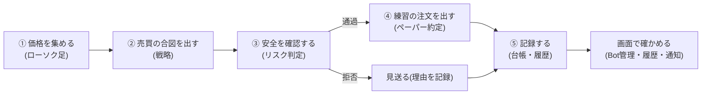
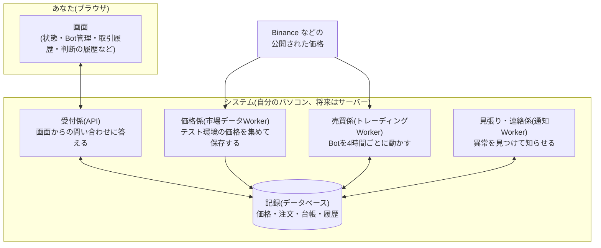
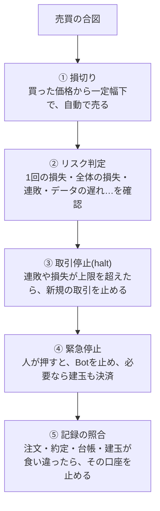

# AI System Trading とは — 全体像(非エンジニア向け)

> このドキュメントは、プログラムを書かない方が、「このシステムは何をしていて、何をしていないのか」を理解するためのものです。
> 売買の考え方は [02-trading-logic.md](02-trading-logic.md)、開発者向けの仕様は [../design/system-specification.md](../design/system-specification.md) にあります。
> 最終更新: 2026-10-12(現在の実装に基づく)。

## 1. ひとことで言うと

**「価格の動きを見て、ルールどおりに売買の練習(ペーパートレード)を自動で行い、その成績と理由を、画面でいつでも確かめられるようにするシステム」** です。

| | できること | できないこと(しないこと) |
|---|---|---|
| お金 | 仮想のお金(例: 166,667 USDT)で売買の練習をする | **本物のお金は一切使わない。本物の注文は一切出さない** |
| 売買 | 決まったルールで、6つの暗号資産(BTC・ETH・XRP・ADA・LTC・BNB)を売買する | 人が思いつきで注文する(手動の注文は提供していない) |
| 安全 | 損失を限る仕組み(損切り・リスク判定・取引停止)が、常に働く | 利益を保証する(過去の成績は、将来を約束しない) |

> **重要な約束事**: このシステムは「練習用」です。取引所の本物の口座には、注文を送りません(取引所の「テスト環境」や、公開されている価格だけを使います)。
> 本番の取引に進む場合は、別のプロジェクトとして、改めて相談して決めます。

## 2. 全体の流れ

システムは、次の5つの段階を、**4時間ごと**(4時間足が確定するたび)に繰り返します。

1. **価格を集める**: Binance の公開価格(登録不要)を、4時間ごとの「ローソク足」として取り込みます。売買の練習に使う価格は、売買係が直接取り込み、取引所のテスト環境の価格は、価格係が集めます。
2. **売買の合図を出す**: 「戦略」と呼ぶルールが、「買う」「売る」「何もしない」のどれかを決めます(詳しくは [02](02-trading-logic.md))。
3. **安全を確認する**: 合図が出ても、すぐには注文しません。「リスク判定」が、損失が大きくなりすぎないかを確認します。
4. **練習の注文を出す**: 通過したら、システムの中で、売買が成立したことにします(取引所には送りません)。
5. **記録する**: 注文・約定・お金の出入り・「なぜそう判断したか」を、すべて残します。あとから理由を追えます。

## 3. システムを構成する部品

「何が動いていて、誰が何をしているか」を、役割で整理します。

- **受付係(API)**: 画面の表示に必要な情報を、記録から取り出して返します。権限(閲覧だけ・操作できる・管理者)も、ここで確認します。
- **価格係**: 取引所のテスト環境の価格を取り込み続けます。(売買の練習に使う公開価格は、売買係が、評価のたびに直接取り込みます。)止まると、チャートや欠損の確認に影響します。
- **売買係**: 動いているBotを順番に確認し、新しい足が確定していたら、戦略 → リスク判定 → 練習の注文までを行います。
- **見張り・連絡係**: 売買係や価格係が止まっていないか、記録に矛盾が無いかを見て、異常があれば**画面と(設定すれば)メール**で知らせます。
- **記録(データベース)**: すべての出来事を残す場所です。画面は、これを読んでいるだけです。

## 4. 「Bot」と「口座」

- **Bot** は、「ある銘柄を、あるルールで売買する担当者」です。いまは、6銘柄ぶんのBotが、ルールの違う2組(合計12台)で動いています。
- **口座** は、Botごとに1つずつ持つ、仮想のお金の入れ物です。資金は6銘柄に均等に分け、1つのBotの資金は 166,667 USDT(合計 100万 USDT)です。
  Botの資金は混ざらないので、1つのBotの失敗が、他のBotの資金を減らすことはありません。
- Bot は「稼働中」「一時停止」「停止」「失敗」の状態を持ちます。一時停止中は、新しく買いませんが、持っている分の決済はできます。

## 5. 安全のしくみ(多重の安全装置)

損失を限るために、性質の違う安全装置を重ねています。

| 装置 | 何をするか | 解除 |
|---|---|---|
| ① 損切り | 買った価格から、値動きの大きさ(ATR)の2倍だけ下がったら、自動で売って損を確定する | (自動) |
| ② リスク判定 | 1回の取引で失ってよい額(資金の0.5%)を超えないよう、買う量を決める。上限を超える注文は拒否する | (注文のたびに判定) |
| ③ 取引停止 | 日次・週次の損失、最高値からの下落、連敗が上限を超えたら、**新規の取引だけ**を止める(決済はできる) | 連敗・下落のロックは**管理者(Owner)が解除**。データ遅れ等は回復で自動 |
| ④ 緊急停止 | 人がボタンを押して、Botを止める。「建玉を成行で決済する」も選べる | 管理者(Owner)だけが解除 |
| ⑤ 記録の照合 | 5分ごとに、注文・約定・台帳・建玉が食い違っていないか確認し、食い違えば口座を止めて通知する | 直したうえで管理者が解除(食い違いが残っていると解除できない) |

**止まったときは、知らせが届きます**: 取引停止・Workerの停止・Botの失敗・記録の食い違いは、画面の「システム状態」「通知」に出ます。

## 6. 画面の見方

画面の上部のメニューから、次のページに移れます。

| ページ | 何が分かるか | こんなときに見る |
|---|---|---|
| 開発状態 | システム自体(API・データベース)が動いているか | 画面が開かないとき |
| **システム状態** | 全体の健康状態(正常 / 要確認)、Workerの稼働、取引停止、通知 | 毎日の最初の確認 |
| イベントログ | 停止・異常などの出来事を、時系列で検索 | 「いつ何が起きたか」を遡るとき |
| 欠損データ | 価格データの抜け(欠損)と、補完の状況 | 「データに穴があるのでは」と思ったとき |
| 接続管理 | 取引所との接続(テスト環境)の設定 | 最初の設定のとき |
| 市場(OANDA・Binance・公開履歴) | ローソク足のチャート。**自分の売買(買い・売り・損切り)が、チャートに重なって見える** | 売買が、価格のどこで行われたかを見たいとき |
| **Bot管理** | Botごとの資金・損益・持っている建玉。緊急停止・開始・停止 | Botの状態を見たい・操作したいとき |
| **取引履歴** | これまでの約定(いつ・何を・いくらで)と、その結果 | 成績を確認したいとき |
| **判断の履歴** | Botが足ごとに「買った/見送った」理由。取引が無い理由も分かる | 「なぜ取引していないのか」を知りたいとき |
| バックテスト | 過去の価格で、戦略をやり直した成績(複数銘柄の比較も可) | 戦略の過去の成績を確認したいとき |

### 「取引が無い」のは、普通のことです

承認されている戦略は、**ほとんどの足で何もしません**(過去の検証では、1銘柄あたり、年に15回前後しか売買しません)。「判断の履歴」を見ると、次のように理由が分かります。

- 様子見(hold): 買いの条件も、売りの条件も、満たしていない(ふつう、これがほとんど)
- リスク判定で拒否: 例えば、Binance は「売りから入る(空売り)」ができないため、売りの合図は、持っている分を決済するとき以外は拒否される
- 停止中で見送り: 取引停止(halt)が、新規の取引を止めていた

## 7. 検証の結果と、その限界(正直な説明)

過去の価格でのバックテスト(約9年、6銘柄に均等配分。3か月の準備期間のあとの1か月を検証区間として、区間をずらしながら繰り返す方式)では、次の結果でした。

| | 戦略 | 同じ量の買い持ち |
|---|---|---|
| 年率リターン | 約 +6.4% | 約 +7.2% |
| 最大の下落(最大ドローダウン) | **5.8%** | 13.6% |
| 最悪の1日 | -3.4% | -2.9% |

- **損失の小ささ**が、この戦略の狙いです(「大きく儲ける」より「損をしない」を優先)。最大の下落が、買い持ちの半分以下に収まりました。
- ただし、次の**限界**があります。
  - **過去の結果は、将来を保証しません。** 直近の2025〜2026年は、ほぼ横ばい(年+0.4%前後)でした。
  - **生存バイアス**があります。検証した6銘柄は「いま取引できる銘柄」から選んだので、その後に消えた銘柄は含まれません。
  - 6銘柄のうち、LTC は赤字(年-1.8%)で、BNB は後半が赤字でした。分散して初めて、安全の基準を満たしました。
  - 「含み損の期間」が長い(最長で約900日、最高値を更新できない)ことがあります。
  - ペーパーでの実績は、2026年10月に始めたばかりで、まだ少数です。**だから、この練習運用で「未来のデータでの検証」をしています。**

## 8. 用語集

| 用語 | 意味 |
|---|---|
| ペーパートレード | 本物のお金を使わない、売買の練習。注文はシステムの中だけで成立する |
| ローソク足 | 一定時間(例: 4時間)の、始値・高値・安値・終値を1本で表したもの |
| 戦略 | 「いつ買い、いつ売るか」を決めるルール |
| シグナル | 戦略が出す合図(買い・売り・何もしない=hold) |
| 約定 | 注文が成立すること。成立した価格・数量・手数料が記録される |
| 建玉(たてぎょく) | いま持っている売買の状態(ポジション) |
| 損切り | 損が大きくなる前に、あらかじめ決めた価格で売って、損失を限ること |
| ATR | 値動きの大きさの目安(直近14本の平均的な値幅) |
| 最大ドローダウン | 資産が、最高値から、最大でどれだけ下がったか |
| バックテスト | 過去の価格で、戦略を再現して、成績を調べること |
| リスク判定(Risk Gate) | 注文の前に、損失が大きくなりすぎないか確認する関門 |
| 取引停止(halt) | 新規の取引を止める状態。原因と段階がある |
| 台帳 | お金の出入りの記録。残高や損益は、ここから計算される |
| Worker | 画面とは別に、裏で動き続けるプログラム |
| Owner / Operator / Viewer | 権限。Owner=管理者(解除などもできる)、Operator=操作できる、Viewer=見るだけ |
