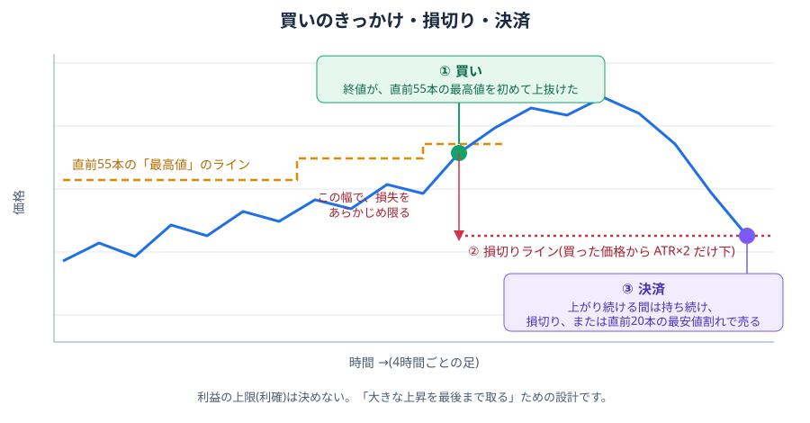
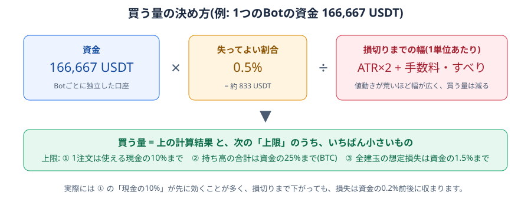
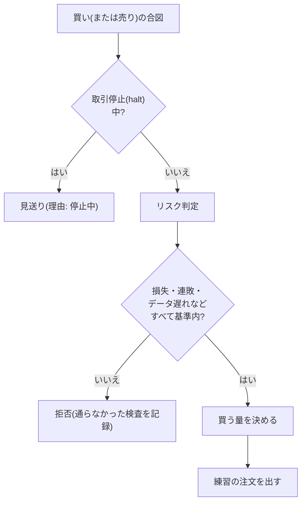
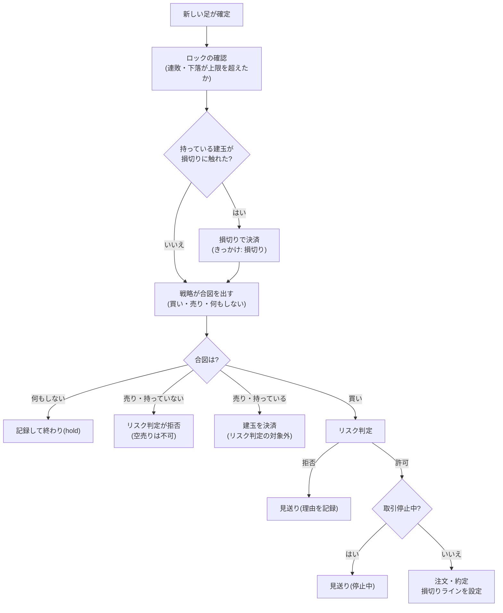

# トレードロジックの説明(非エンジニア向け)

> 「Botは、どんなルールで、いつ買い、いつ売り、どれだけ買うのか」を、図と例で説明します。
> 全体像は [01-system-overview.md](01-system-overview.md)、実装の細部(数式・関数・データ)は [../design/system-specification.md](../design/system-specification.md) を参照してください。
> 最終更新: 2026-10-12。**ここで説明するのは、ペーパートレード(練習)のルールです。本物のお金・本物の注文は使いません。**

## 1. 戦略の考え方: 「上昇の勢いに乗る」

承認されている戦略は、**ドンチャン・ブレイクアウト(Donchian breakout)** という、昔からある「トレンドフォロー」(流れに乗る)型のルールです。

- 価格が、**直近の高値を上抜けた**ら、「上昇の勢いが出た」と見て買います。
- 一度買ったら、**上がり続ける間は持ち続け**、勢いが止まったら(損切り、または直近の安値割れ)売ります。
- **利益の上限(利確)は決めません。** 「小さく損をして、大きな上昇を最後まで取る」ことで、全体として損が少ない形を狙います。

> たとえ: 川の流れに乗る船のようなものです。流れが強くなったら乗り、流れが止まったら降ります。流れの先を予想はしません。

## 2. 買い・損切り・決済

| 段階 | ルール | 具体的には |
|---|---|---|
| ① 買い | 4時間足の**終値**が、**直前55本の最高値**を、**初めて**上抜けたとき | 上抜けた「最初の足」だけ。上にいる間、毎回は買わない |
| ② 損切り | 買った価格から、**ATR(値動きの大きさ)の2倍**だけ下に、損切りのラインを置く | 次の足から、安値がラインに触れたら、そのライン(窓を開けて下に飛んだときは、その始値)で売る |
| ③ 決済 | 損切りに触れるか、**終値が直前20本の最安値を下抜けた**とき | 上がり続ける間は、何もしない(持ち続ける) |

- **「55本」「20本」とは**: 4時間足の本数です。55本は約9日、20本は約3日分の値動きです。
- 別の組(「110本・40本」、約18日・約7日)も、比較用に、同じ6銘柄で動かしています。
- 「初めて」とは、上抜けた**最初の足**だけを指します。上にいる間ずっと買い続けて、買いすぎるのを避けるためです。

### 買い増し・売り(空売り)・利確

- **買い増し**: 持っている間に、新しい上抜けが出たら、リスク判定の上限の範囲で、買い増します。損切りのラインは、**最初の買いのまま**です。
- **売りから入る(空売り)はしません。** Binance の現物では、そもそもできません。売りの合図が出ても、持っている分を決済するとき以外は、リスク判定が拒否します
  (判断の履歴に「空売りは不可」と出ます)。
- **利確(利益の上限で売る)はしません。** 過去の検証で、利確や「値上がりに合わせて損切りを引き上げる」方式は、利益を大きく減らすため、採用していません。

## 3. どれだけ買うか(資金の使い方)

「1回の取引で、**損切りまで下がったとき**に失ってよい額」を、資金の**0.5%**と決め、そこから買う量を逆算します。

> **実際の判定の記録から(BTCUSDT)**: 資金 166,667 USDT、価格 82,757 USDT、損切りまでの幅 約 1,525 USDT(ATR×2)。
> 損失の限度 = 166,667 × 0.5% ≒ 833 USDT。損切り幅には手数料の見込み(約 83 USDT)を足して約 1,608 USDT として割るので、計算上の量は **0.518 BTC**(約 42,900 USDT 分)。
> しかし、上限「1注文は使える現金の10%(約 16,667 USDT)まで」が先に効き、**実際の注文は 0.2014 BTC**。
> 損切りまで下がっても、損失は 約 307 USDT(資金の約 0.18%)に収まります。

| 上限 | 内容 |
|---|---|
| 1回の損失 | 損切りまで下がったときの損失が、資金の0.5%を超えない(絶対の上限は2%) |
| 1注文の大きさ | 使える現金の10%まで |
| 持ち高の大きさ | BTC の保有が、資金の25%まで |
| 全建玉の想定損失 | 資金の1.5%まで(絶対の上限は5%) |

**値動きが荒い(ATRが大きい)ほど、買う量は自動で減ります。** 荒い相場で、損失が膨らむのを避けるためです。

## 4. 注文の前の「リスク判定」(関門)

合図が出ても、次の関門を、すべて通らないと注文されません。**拒否された理由は、すべて記録され、「判断の履歴」で読めます。**

リスク判定が確認する主な項目(`conservative-v1` という名前の、承認済みの設定):

| 確認すること | 通常の基準 | 絶対の上限(超えたら強く止める) |
|---|---|---|
| 1回の取引の想定損失 | 資金の 0.5% | 2% |
| 全建玉の想定損失の合計 | 1.5% | 5% |
| 1日の損失 | 2% | 5% |
| 1週間の損失 | 4% | 8% |
| 最高値からの下落(ドローダウン) | 5% | 10% |
| 連敗 | 3連敗まで(4連敗になる状態では拒否) | 7連敗まで(8連敗になる状態では強く止める) |
| 前回の注文からの間隔 | 15分以上 | 1分 |
| 価格データの遅れ | 2本まで | 5本 |
| 空売り | **不可(Binance)** | — |

> 「通常の基準」を超えたら、その注文は拒否します。「絶対の上限」を超えたら、さらに、取引停止(halt)にします。

## 5. 取引停止(halt): 新規の取引を止める

| 原因 | 止める範囲 | 止まる内容 | 解除 |
|---|---|---|---|
| 価格データの遅れ | そのBot | 新規の取引 | データが回復したら、自動(1段ずつ) |
| 1日・1週間の損失、最高値からの下落(絶対の上限) | 口座またはBot | 新規の取引 | 基準に戻れば、自動(1段ずつ) |
| **連敗・最大ドローダウンのロック** | その口座 | 新規の取引 | **管理者(Owner)が解除**。解除した時点から、数え直す |
| **記録の食い違い**(注文・台帳・建玉) | その口座 | 新規の取引(緊急停止の段階) | 直したうえで、管理者が解除 |
| **人による緊急停止** | Botまたはワークスペース全体 | Botを止める(建玉は残すか、決済するかを選べる) | 管理者だけが解除(Botは止まったまま) |

- 止まっている間も、**持っている建玉の決済(損切り)はできます。**
- 連敗や下落のロックを、**自動で解除しない**のは、「練習で一時的に戻っても、戦略が信頼できる状態に戻ったとは言えない」ためです。人が確認してから再開します。

## 6. 1回の評価の流れ(4時間ごと、Botごと)

新しい4時間足が確定するたびに、Botは、次の順で1回だけ評価します(同じ足を2回評価しても、記録は増えません)。

評価の結果は、すべて「判断の履歴」に、足ごとに残ります(様子見・発注・決済・拒否・停止中の見送り・一時停止中の見送り)。

## 7. 注文が成立する(約定)しくみ — ペーパー

- 注文は、**システムの中だけで**成立します。取引所には送りません。
- 価格は、**最新に確定した足の終値**を使います(そのため、約定価格は、合図を出した足の終値と一致します)。
- 手数料は、約定代金の **0.1%**(Binance の想定)。スリッページ(注文価格と約定価格のずれ)は、公開されている「最良の売値と買値の差」から見積もります。
- 約定のたびに、お金の出入りを「台帳」に記録し、建玉(持ち高)を更新します。残高・損益・資産は、すべて台帳から計算します。

## 8. なぜ、この戦略なのか(検証の道のり)

過去の価格で、候補を比べて、「損をしない」基準(最大ドローダウン10%以内、買い持ちより下落局面の損が小さい、全期間でプラス)を満たすものを選びました。

| 検証したこと | 結論 |
|---|---|
| 単純な移動平均の交差(最初の試作) | 採用せず(研究用に残すのみ) |
| 出口の方式(損切りのみ / 損切り+利確 / トレーリング) | **損切りのみ(利確なし)が最良**。利確・トレーリングは、損失は減るが、利益をそれ以上に削る |
| 損切りを、より細かい足で監視する | 損益は変わらない(気づくまでの速さが変わるだけ)。判断は4時間足のまま |
| 判断に使う時間足(1時間〜1日) | 見ている**期間の長さ**が重要。4時間・約9日が、安定した帯に入る |
| 複数銘柄に分けて運用 | 単独のBTCより、6銘柄の均等配分のほうが、最大の下落が小さい(8.8% → 5.8%) |
| 複数の指標で絞り込む | 採用せず |

詳しい数字と条件は、それぞれ `docs/plans/` の検証メモ(`rolling-walk-forward.md`、`multi-asset-diversification.md`、`decision-timeframes.md`、`stop-monitoring-timeframes.md`、`confluence-filters.md`)にあります。

> **限界(再掲)**: すべて過去の価格での結果です。直近の2025〜2026年は、ほぼ横ばいでした。
> ペーパートレードは、バックテストでは確認できない「未来のデータでの検証」のために行っています。

## 9. 承認されている設定の一覧

| 項目 | 値 |
|---|---|
| 銘柄 | BTC・ETH・XRP・ADA・LTC・BNB(いずれも USDT 建て) |
| 時間足 | 4時間足 |
| 買い | 終値が、直前55本の最高値を、初めて上抜けた足 |
| 決済 | 損切り、または終値が直前20本の最安値を下抜けた足 |
| 損切り幅 | ATR(14本)×2(Binance) |
| 利確 | なし |
| 資金 | 1口座あたり 166,667 USDT(6銘柄、合計 100万 USDT)。Botごとに独立 |
| 買う量 | 資金の0.5% ÷ 損切り幅。1注文は現金の10%、BTC保有は資金の25%まで |
| 空売り | しない |
| 比較用 | 110本・40本(約18日・約7日)の組も並行して動かす |

> 新しいBotは、**承認済みの戦略(55/20 + 損切り、4時間足)でしか作れません**。検証していない戦略や時間足は、画面からも作れないようにしています。
> 設定を変える場合は、再検証してから変えます。
